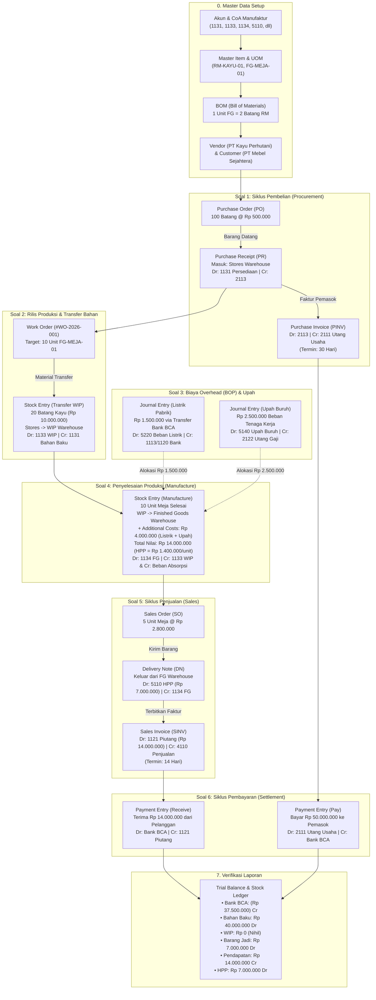

# SKEMA ALUR KERJA (FLOWCHART) PENGERJAAN SOAL ERPNEXT MANUFAKTUR
**Simulasi Kasus: PT Furnitur Kayu Jaya**

Dokumen ini memetakan seluruh arsitektur proses bisnis dari pengadaan bahan baku, proses manufaktur, pencatatan biaya overhead dan tenaga kerja, hingga siklus penjualan dan penyelesaian pembayaran.

---

## 1. Diagram Alur Transaksi End-to-End

---

## 2. Matriks Pemetaan Dokumen & Aliran Fisik Gudang

| Tahapan | Dokumen ERPNext | Gudang Asal | Gudang Tujuan | Perubahan Nilai Persediaan |
| :--- | :--- | :---: | :---: | :--- |
| **Pengadaan** | `Purchase Receipt` | Pemasok Luar | `Stores Warehouse` | `+ Rp 50.000.000` (Bahan Baku Masuk) |
| **Rilis Bahan** | `Stock Entry (Transfer)` | `Stores Warehouse` | `Work In Progress` | `Stores: -Rp 10.000.000` \| `WIP: +Rp 10.000.000` |
| **Barang Jadi**| `Stock Entry (Manufacture)`| `Work In Progress` | `Finished Goods` | `WIP: -Rp 10.000.000` \| `FG: +Rp 14.000.000` *(+4jt Biaya Konversi)* |
| **Pengiriman** | `Delivery Note` | `Finished Goods` | Pelanggan Luar | `FG: -Rp 7.000.000` *(Diakui sebagai HPP)* |

---

## 3. Matriks Aliran Jurnal Akuntansi

| No | Transaksi | Akun Debet (Dr) | Akun Kredit (Cr) | Nominal (Rp) |
| :---: | :--- | :--- | :--- | :---: |
| **1a** | Penerimaan Barang Pembelian | `1131 - Persediaan Bahan Baku` | `2113 - Barang Belum Ditagih` | 50.000.000 |
| **1b** | Pengakuan Faktur Pembelian | `2113 - Barang Belum Ditagih` | `2111 - Utang Usaha Pemasok` | 50.000.000 |
| **2** | Pengeluaran Bahan ke WIP | `1133 - Persediaan WIP` | `1131 - Persediaan Bahan Baku` | 10.000.000 |
| **3a** | Bayar Listrik Pabrik | `5220 - Listrik, Air & Gas Pabrik` | `1113/1120 - Bank BCA` | 1.500.000 |
| **3b** | Akrual Upah Buruh Pabrik | `5140 - Upah Buruh Langsung` | `2122 - Utang Gaji Buruh` | 2.500.000 |
| **4** | Penyelesaian Produk Jadi | `1134 - Persediaan Barang Jadi` | `1133 - Persediaan WIP` `5220 - Alokasi Listrik` `5140 - Alokasi Upah` | 14.000.000 *(Kredit: 10jt WIP + 1.5jt Listrik + 2.5jt Upah)* |
| **5a** | Pengiriman Barang (HPP) | `5110 - Pemakaian Bahan / HPP` | `1134 - Persediaan Barang Jadi` | 7.000.000 |
| **5b** | Penjualan Produk Jadi | `1121 - Piutang Usaha Lokal` | `4110 - Penjualan Produk Jadi` | 14.000.000 |
| **6a** | Terima Pelunasan Piutang | `1113/1120 - Bank BCA` | `1121 - Piutang Usaha Lokal` | 14.000.000 |
| **6b** | Bayar Pelunasan Utang Pemasok | `2111 - Utang Usaha Pemasok` | `1113/1120 - Bank BCA` | 50.000.000 |
